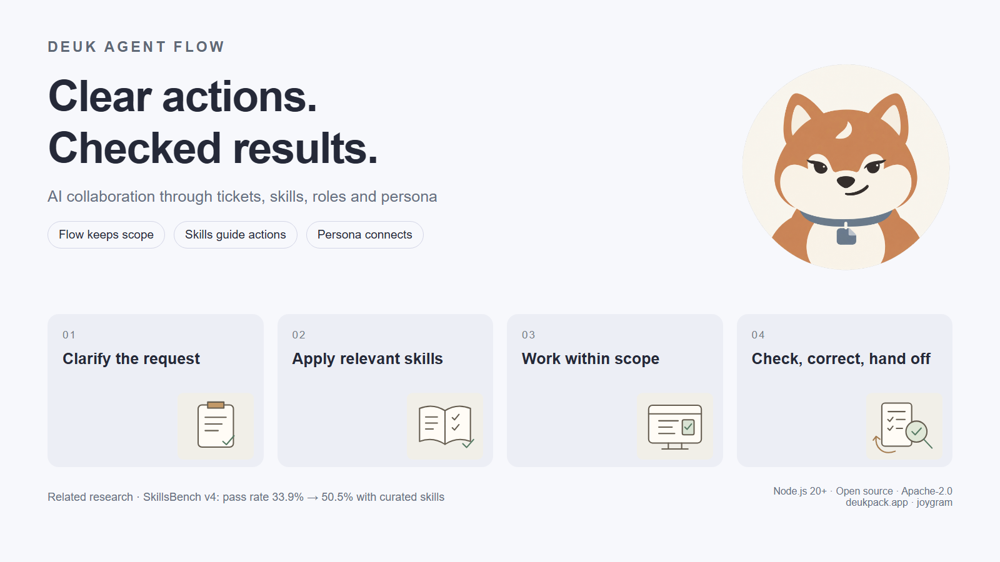

# Deuk Agent Flow for VS Code

- Ticket, skill and handoff controls for human–AI collaboration.
- Tickets = goals, scope, approval, execution evidence and follow-ups.
- Skills = task-specific procedural criteria; roles = stage-specific expertise.
- Persona = optional conversation style; Deuki = the Shiba Inu product companion.

## Use

- Install the extension and the `deuk-agent-flow` CLI; initialize the project with `deuk-agent-flow init`.
- Select a workspace; inspect tickets and copy the active task handoff into your agent chat.
- Use skill controls to inspect installation and platform exposure.
- Review scope before execution; inspect actual verification evidence at completion.

## 한국어

- 티켓·스킬·인계를 VS Code에서 확인하는 AI 협업 패널.
- 워크스페이스 선택·티켓 조회·인계 복사·스킬 노출 상태 제어.
- 득이 = 제품 캐릭터; 선택형 대화 페르소나와 독립.

## Learn more

- [Product overview](https://github.com/joygram/DeukAgentFlow#readme) · [한국어](https://github.com/joygram/DeukAgentFlow/blob/main/README.ko.md).
- [Website](https://deukpack.app/deuk-agent-flow/) · [Research](https://deukpack.app/deuk-agent-flow/research/).
- Apache-2.0 · joygram.
